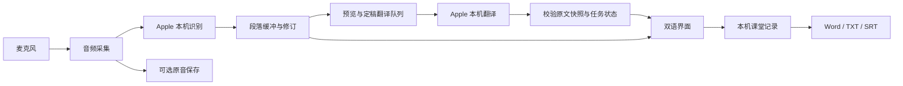

# ClassScribe · 听课译记

A native macOS app for on-device English lecture transcription and Simplified Chinese translation.

听课译记是一个在 Mac 本机运行的英文课堂转录与中文翻译工具。通过麦克风接收语音，显示英文原文与中文译文，按段落整理内容，并保存课堂记录和可选原音。项目来自日常上课时的实际需要，现公开源码，欢迎使用、反馈和共同改进。当前版本为 **1.4.0**。


*演示图由应用的真实 SwiftUI 视图离屏渲染，内容为明确标注的合成示例，未启用麦克风；不作为识别准确率证据。*

[使用说明](docs/USER_GUIDE.zh-CN.md) · [参与贡献](CONTRIBUTING.md) · [开发文档](docs/ENGINEERING.md) · [验证范围](docs/VALIDATION.md) · [MIT 许可证](LICENSE)

## 解决的问题

- 课堂中需要尽快看到中文，同时保留英文原文用于核对。
- 连续逐句翻译容易割裂上下文，需要段落级翻译与即时预览配合。
- 一堂课可能中途暂停，恢复后应保留已有记录并接续录音时间轴。
- 课后需要可编辑、可导出的记录，以及可追查识别错误的原音。

## 功能

- **本机英文识别与中文翻译**：使用 Apple Speech 与 Translation 框架；首次准备语言包需要联网。
- **段落与逐句模式**：支持约 15、25、40 秒的目标段落长度，保留识别原始片段和时间范围。
- **实时中文预览**：段落未结束时提前翻译，清楚标记预览；段落结束后再进行整段定稿。
- **暂停与继续**：暂停停止收音和计时；恢复后接回同一课堂，原音保存为独立片段，暂停时间不计入录音时间轴。
- **课堂记录管理**：自动保存、停止后编辑、翻译重试、删除确认与移到废纸篓。
- **导出**：双语 Word、TXT、SRT，以及复制文字。

## 技术实现

| 层次 | 技术与职责 |
| --- | --- |
| 界面 | SwiftUI、AppKit：课堂列表、双语内容、设置、原生导出窗口 |
| 音频 | AVAudioEngine：麦克风采集、格式转换、可选 CAF 原音保存 |
| 识别 | SpeechAnalyzer、SpeechTranscriber：本机连续英文识别、临时与定稿结果 |
| 翻译 | TranslationSession：设备端英译简体中文 |
| 应用逻辑 | Swift Concurrency：状态转换、翻译队列、取消、过期回复校验 |
| 数据 | Codable / JSON：课堂记录、时间范围、原始识别片段与翻译状态 |



识别和翻译模型由 Apple 提供。本项目的工作集中在音频流程、识别结果修订、段落组织、异步翻译调度、暂停恢复、数据保存和桌面交互。当前应用不调用第三方云端识别或翻译 API。

## 开始使用

当前通过下方命令从源码构建。生成应用后，可将“听课译记.app”复制到 Mac 的“应用程序”文件夹。

1. 首次打开时点击“准备语言包”，联网安装系统英语识别和英中翻译语言包。
2. 新建课堂，可在收音设置中填写专业词、人名和缩写。
3. 点击“开始听课”并允许麦克风访问，查看英文原文和中文预览。
4. 中途可暂停、继续；下课后停止听课，等待末段文字保存和翻译完成。
5. 根据原音核对文字，必要时编辑，再导出 Word、TXT 或双语 SRT。

详细操作、保存位置和常见问题见[使用说明](docs/USER_GUIDE.zh-CN.md)。

## 运行条件

- Apple Silicon Mac。
- macOS 26 或更新版本。
- 构建需要支持 macOS 26 SDK 的 Xcode。
- 构建打包使用 Python 3；默认入口为 `/usr/bin/python3`，可通过 `CLASSSCRIBE_PYTHON` 指定其他 Python 3。
- 首次准备英语识别和英中翻译语言包时需要联网。
- 麦克风在用户开始听课并授权后启用。

语言包和课堂数据位于运行电脑本机。默认记录位置为 `~/Library/Application Support/ClassScribe/`。把应用放进“应用程序”后，日常运行不需要源码目录或外接硬盘。

## 构建与测试

获取源码：

```sh
git clone https://github.com/he257743/class-scribe.git
cd class-scribe
```

在仓库根目录运行：

```sh
zsh build.sh
zsh Tests/run.sh
python3 Tools/VerifyPackage.py dist/听课译记.zip
```

构建脚本编译原生应用、进行本机签名并生成分发 ZIP。开发签名不等于 Apple 公证；正式分发仍需遵循系统安装与签名要求。

ZIP 位于 `dist/听课译记.zip`；本机已签名应用的构建路径写入 `build/latest-app-path.txt`。Swift 源码不依赖 Python 包或第三方模型文件。

`.github/workflows/checks.yml` 在 Apple Silicon `macos-26` runner 上执行构建、逻辑回归与 ZIP 检查，结果见 [GitHub Actions](https://github.com/he257743/class-scribe/actions/workflows/checks.yml)。原生语言包测试不在 CI 中自动执行。

可选的原生管线检查需要预先安装系统语言包：

```sh
zsh Tests/run-native.sh
```

该脚本使用 macOS `say` 生成合成英语音频，并调用真实的系统识别和翻译。默认使用 Samantha 语音，可通过 `CLASSSCRIBE_TEST_VOICE` 指定已安装的英语语音；不启用麦克风。

演示图可由源码重新生成：

```sh
zsh Tools/render-demo.sh
```

回归测试覆盖转录修订、课堂删除、段落边界、实时预览、暂停恢复及相关失败路径。模拟录音后端和可控制时钟用于验证时间轴与异步行为。

测试证据应与能力边界一起阅读：

- 构建和逻辑测试通过，不代表真实课堂准确率已测定。
- 原生识别管线曾用本机合成英语音频验证；翻译曾用 Apple 原生翻译会话验证。
- 真实麦克风暂停操作、课堂远场效果和长时间稳定性仍需持续实测。
- 不承诺完全无误的转录；专业术语和含混语音需要对照原音核查。

## 当前范围

当前输入为麦克风英语，目标语言为简体中文。段落边界主要基于时间和停顿启发式，不等同于语义上的知识点边界；中文预览可能随上下文修订。系统音频采集、说话人分离和自动中英文切换尚未实现。

## 后续方向

- 用获得使用授权的课堂样本建立人工标准稿，测量词错误率与端到端延迟。
- 增加专业术语表与翻译一致性检查。
- 完善真实设备测试、无障碍体验和正式签名分发。

## 开发说明

项目使用 AI 编程工具辅助实现与测试整理。项目介绍区分应用自身实现和系统模型能力，测试结论以可复现记录为准。公开仓库仅应包含源码、说明、测试和合成示例，不包含私人课堂录音或个人课堂记录。

欢迎通过 Issues 反馈问题或提出建议，也欢迎提交修复和文档改进。具体步骤见[参与贡献](CONTRIBUTING.md)。

## 许可证

本仓库采用 [MIT 许可证](LICENSE)。保留版权和许可声明即可使用、修改和分发本项目。应用依赖的 Apple 系统框架和语言包由 macOS 提供。
