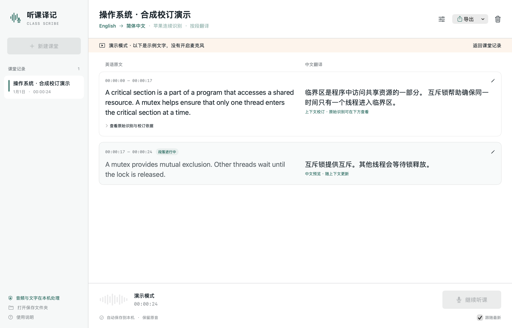
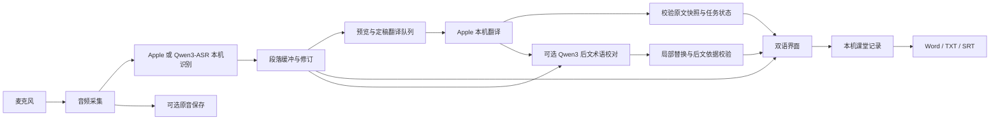
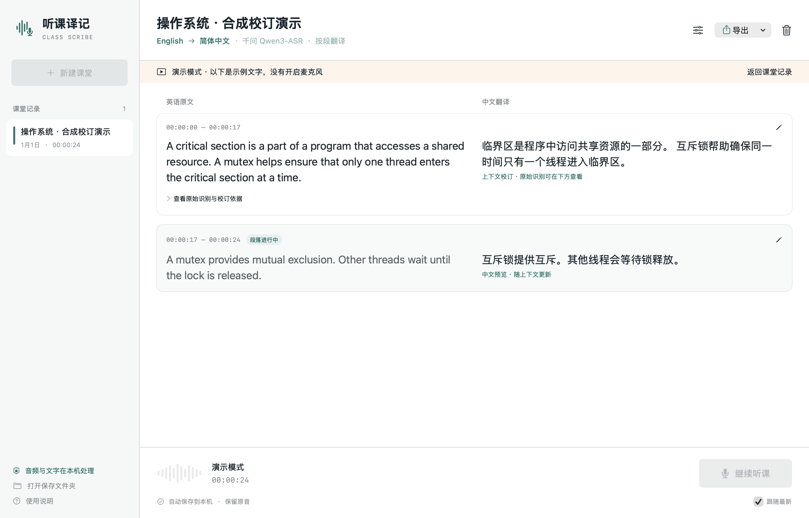

# ClassScribe · 听课译记

A native macOS app for on-device English lecture transcription and Simplified Chinese translation.

听课译记是一个在 Mac 本机运行的英文课堂转录与中文翻译工具。通过麦克风接收语音，显示英文原文与中文译文，按段落整理内容，并保存课堂记录和可选原音。项目来自日常上课时的实际需要，现公开源码，欢迎使用、反馈和共同改进。当前版本为 **1.6.0**。



*演示图由应用的真实 SwiftUI 视图离屏渲染，内容为明确标注的合成示例，未启用麦克风；不作为识别准确率证据。*

[使用说明](docs/USER_GUIDE.zh-CN.md) · [参与贡献](CONTRIBUTING.md) · [开发文档](docs/ENGINEERING.md) · [验证范围](docs/VALIDATION.md) · [MIT 许可证](LICENSE)

## 解决的问题

- 课堂中需要尽快看到中文，同时保留英文原文用于核对。
- 连续逐句翻译容易割裂上下文，需要段落级翻译与即时预览配合。
- 一堂课可能中途暂停，恢复后应保留已有记录并接续录音时间轴。
- 课后需要可编辑、可导出的记录，以及可追查识别错误的原音。

## 功能

- **可切换的本机英文识别**：选择 Apple Speech 或 Qwen3-ASR；中文翻译使用 Apple Translation。千问识别与上下文校对分别准备，首次下载需要联网。
- **段落与逐句模式**：支持约 15、25、40 秒的目标段落长度，保留识别原始片段和时间范围。
- **实时中文预览**：段落未结束时提前翻译，清楚标记预览；段落结束后再进行整段定稿。
- **可选的后文校对**：使用 Qwen3 本机语言模型回看最近约 90 秒、最多 4 段内容，尝试纠正专业词和中文词义。校订另存，原始识别、初始译文与修订依据可查看。
- **课程术语表**：提供操作系统、计算机网络和软件工程词表，可补充 `mutex=互斥锁` 等自定义术语。
- **暂停与继续**：暂停停止收音和计时；恢复后接回同一课堂，原音保存为独立片段，暂停时间不计入录音时间轴。
- **课堂记录管理**：自动保存、停止后编辑、翻译重试、删除确认与移到废纸篓。
- **导出**：双语 Word、TXT、SRT，以及复制文字。

## 技术实现

| 层次 | 技术与职责 |
| --- | --- |
| 界面 | SwiftUI、AppKit：课堂列表、双语内容、设置、原生导出窗口 |
| 音频 | AVAudioEngine：麦克风采集、格式转换、可选 CAF 原音保存 |
| 识别 | 可选 SpeechAnalyzer / SpeechTranscriber 或 MLX Qwen3-ASR 的分块增量识别；均接入同一段落与翻译流程 |
| 翻译 | TranslationSession：设备端英译简体中文 |
| 后文校对（可选） | Qwen3 + 独立的 Ollama 本机进程：读取最近文字，判断术语修订候选是否符合后文 |
| 应用逻辑 | Swift Concurrency：状态转换、翻译队列、取消、过期回复校验 |
| 数据 | Codable / JSON：课堂记录、时间范围、原始识别片段与翻译状态 |



苹果识别和基础翻译模型由 Apple 提供。千问识别模式通过独立的本机 Python / MLX 进程运行 Qwen3-ASR，音频通过匿名管道传递；推理时关闭模型自动联网获取。可选的后文校对使用单独下载的 Qwen3 语言模型，在 Mac 本机运行；仅向固定的本机回环地址发送最近文字，不发送原音，不使用云端模型回退。

## 开始使用

当前通过下方命令从源码构建。生成应用后，可将“听课译记.app”复制到 Mac 的“应用程序”文件夹。

1. 首次打开时点击“准备语言包”，联网安装系统英语识别和英中翻译语言包。
2. 新建课堂，可在收音设置中填写专业词、人名和缩写。
3. 点击“开始听课”并允许麦克风访问，查看英文原文和中文预览。
4. 中途可暂停、继续；下课后停止听课，等待末段文字保存和翻译完成。
5. 根据原音核对文字，必要时编辑，再导出 Word、TXT 或双语 SRT。

需要切换识别引擎时，在右上角设置选择“千问 Qwen3-ASR”，再点击准备组件。识别模型约 1.6GB，另有 Python / MLX 组件；初次开始需要加载模型。翻译层继续使用苹果模型。

需要后文校对时，在右上角设置中选择课程领域和上下文模型，再点击“准备上下文模型”。这一步与苹果语言包分开，未准备时仍可使用基础识别和翻译。

首次需额外下载约 187MB 运行组件，以及约 523MB 的轻量模型或约 1.4GB 的较大模型。较大模型会增加内存、算力和磁盘占用；校订完成时间取决于本机负载，可以关闭此功能。

详细操作、保存位置和常见问题见[使用说明](docs/USER_GUIDE.zh-CN.md)。

## 运行条件

- Apple Silicon Mac。
- macOS 26 或更新版本。
- 构建需要支持 macOS 26 SDK 的 Xcode。
- 构建打包使用 Python 3；默认入口为 `/usr/bin/python3`，可通过 `CLASSSCRIBE_PYTHON` 指定其他 Python 3。
- 首次准备英语识别和英中翻译语言包时需要联网。
- 麦克风在用户开始听课并授权后启用。

语言包和课堂数据位于运行电脑本机。默认记录位置为 `~/Library/Application Support/ClassScribe/`。把应用放进“应用程序”后，日常运行不需要源码目录或外接硬盘。

## 构建与测试

获取源码：

```sh
git clone https://github.com/he257743/class-scribe.git
cd class-scribe
```

在仓库根目录运行：

```sh
zsh build.sh
zsh Tests/run.sh
python3 Tools/VerifyPackage.py dist/听课译记.zip
```

构建脚本编译原生应用、进行本机签名并生成分发 ZIP。开发签名不等于 Apple 公证；正式分发仍需遵循系统安装与签名要求。

ZIP 位于 `dist/听课译记.zip`；本机已签名应用的构建路径写入 `build/latest-app-path.txt`。Swift 源码不依赖 Python 包或第三方模型文件。

`.github/workflows/checks.yml` 在 Apple Silicon `macos-26` runner 上执行构建、逻辑回归与 ZIP 检查，结果见 [GitHub Actions](https://github.com/he257743/class-scribe/actions/workflows/checks.yml)。原生语言包测试不在 CI 中自动执行。

可选的原生管线检查需要预先安装系统语言包：

```sh
zsh Tests/run-native.sh
```

该脚本使用 macOS `say` 生成合成英语音频，并调用真实的系统识别和翻译。默认使用 Samantha 语音，可通过 `CLASSSCRIBE_TEST_VOICE` 指定已安装的英语语音；不启用麦克风。

已经准备较大上下文模型后，可选运行实际本机模型检查：

```sh
zsh Tests/run-context-native.sh
```

这组检查输入的是合成识别文字，覆盖术语误听、词义消歧和应保留的原文；不代表真实课堂准确率，也不包含麦克风或语音识别耗时。

演示图可由源码重新生成：

```sh
zsh Tools/render-demo.sh
```

回归测试覆盖转录修订、课堂删除、段落边界、实时预览、暂停恢复、上下文修订保护及相关失败路径。模拟录音后端和可控制时钟用于验证时间轴与异步行为。

测试证据应与能力边界一起阅读：

- 构建和逻辑测试通过，不代表真实课堂准确率已测定。
- 原生识别管线曾用本机合成英语音频验证；翻译曾用 Apple 原生翻译会话验证。
- 真实麦克风暂停操作、课堂远场效果和长时间稳定性仍需持续实测。
- 不承诺完全无误的转录；专业术语和含混语音需要对照原音核查。

## 识别引擎比较



在同一段约 35 秒的合成英语、相同术语列表、关闭额外上下文校对的条件下，按真实时间回放到完整的识别、中文翻译和保存流程：

| 开发样例结果 | Apple | Qwen3-ASR |
| --- | ---: | ---: |
| 英文词错误率（不计标点与大小写） | 2.27% | 0% |
| 首次英文（从音频输入开始） | 1.15 秒 | 3.58 秒 |
| 首次中文（从音频输入开始） | 2.15 秒 | 4.67 秒 |

这是单一合成声音的开发回归样例，不能推断真实课堂准确率；词错误率也不评价断句或中文译文质量。模型启动时间另计。千问另有 Python 进程及 Metal 内存分配，系统服务的完整内存占用未测，不能用宿主进程 RSS 直接比较两种方案的总内存。报告见 [比较记录](validation/backend-comparison.json)。默认仍为苹果识别，可按课程需要切换。

准备两种引擎后可复现：

```sh
zsh Tests/run-backend-comparison.sh
python3 Tools/SummarizeBackendComparison.py build validation/backend-comparison.json
```

## 当前范围

当前输入为麦克风英语，目标语言为简体中文。段落边界主要基于时间和停顿启发式，不等同于语义上的知识点边界；中文预览可能随上下文修订。系统音频采集、说话人分离和自动中英文切换尚未实现。

后文校对基于识别文字，不会重新听音频，也不会补齐漏掉的整句。它只接受有后文引用支持、通过术语和原文状态检查的建议，不等同于理解整堂课。模型仍可能判断错误，请结合原音核查重要内容。

## 后续方向

- 用获得使用授权的课堂样本建立人工标准稿，测量词错误率与端到端延迟。
- 扩展课程词表，并评估术语提示与后文校对的实际效果。
- 完善真实设备测试、无障碍体验和正式签名分发。

## 开发说明

项目使用 AI 编程工具辅助实现与测试整理。项目介绍区分应用自身实现和系统模型能力，测试结论以可复现记录为准。公开仓库仅应包含源码、说明、测试和合成示例，不包含私人课堂录音或个人课堂记录。

欢迎通过 Issues 反馈问题或提出建议，也欢迎提交修复和文档改进。具体步骤见[参与贡献](CONTRIBUTING.md)。

## 许可证

本仓库采用 [MIT 许可证](LICENSE)。保留版权和许可声明即可使用、修改和分发本项目。应用依赖的 Apple 系统框架和语言包由 macOS 提供。

可选运行组件和模型的来源见[第三方组件说明](docs/THIRD_PARTY.md)。模型文件和运行组件不包含在源码仓库中。
