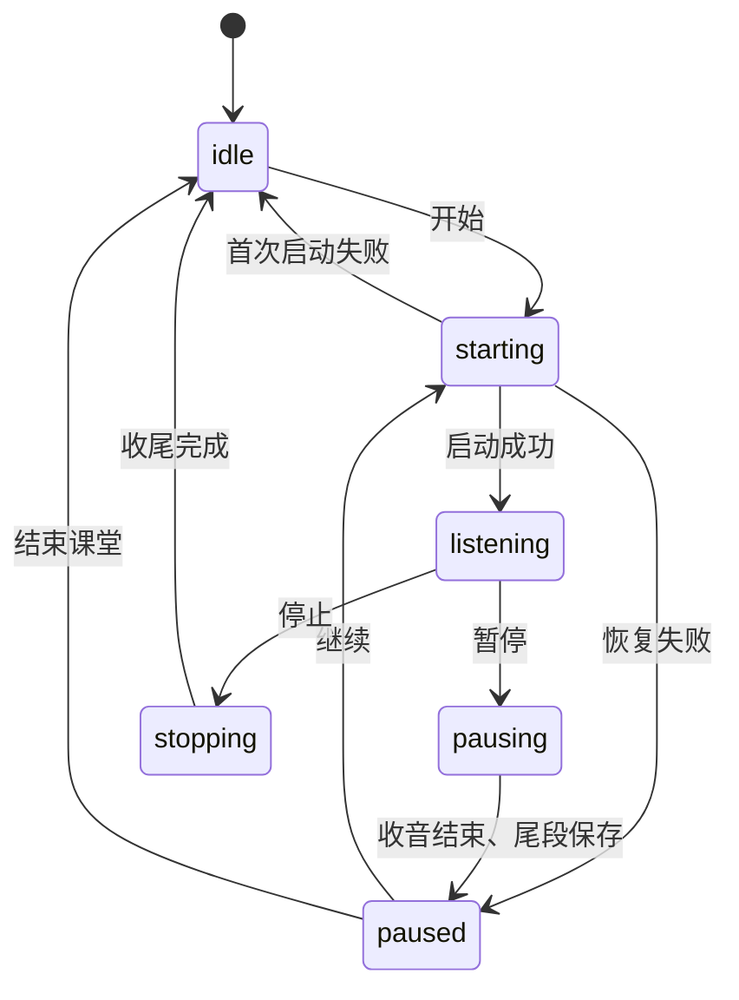

# 工程设计与取舍

## 目标与边界

目标是在 Mac 英文课堂中持续收音，尽快显示中文，并保留英文、时间范围和原音用于课后核对。当前版本为本机单用户应用，无账号系统。基础识别翻译使用系统框架；可选校对通过独立的本机辅助进程运行，不调用远程推理服务。

系统模型提供识别和翻译能力；应用负责输入输出组织、状态和并发控制。当前没有模型训练、微调、说话人分离或语义知识点检测。

## 模块

| 文件 | 职责 |
| --- | --- |
| `Sources/LocalSpeechEngine.swift` | 语言资产检查、AVAudioEngine 采集、音频转换、SpeechAnalyzer 生命周期、识别结果回调 |
| `Sources/Transcript.swift` | 原始片段、时间轴修订、段落缓冲、翻译快照校验、JSON 存储、废纸篓操作、导出 |
| `Sources/ContextReview.swift` | 课程词表、最近上下文窗口、局部修订验证与依据 |
| `Sources/LocalContextService.swift` | 可选运行组件下载与校验、固定回环地址的 Qwen3 推理、进程收尾 |
| `Sources/QwenSpeechEngine.swift` | 本机 Python 子进程、匿名 PCM 管道、就绪检查、结果回调与有界收尾 |
| `Sources/QwenASRAssets.swift` | 固定 Python 发行包校验、可取消的依赖与模型准备 |
| `Resources/QwenASRWorker.py` | 16kHz PCM 接收、非重叠分块、替换式预览、MLX 识别和积压停止 |
| `Sources/AppModel.swift` | 主线程状态、录音生命周期、预览节流、翻译队列、任务失效检查、保存协调 |
| `Sources/ContentView.swift` | 课堂列表、双语视图、设置、编辑和录音控制 |
| `Sources/ClassScribeApp.swift` | 应用入口、菜单、快捷键和退出收尾 |

## 选择系统端侧模型

课堂使用需要便携、及时显示和原音留在本机。Apple Speech 与 Translation 直接提供连续识别、临时结果、设备端翻译和系统语言资产管理，适合原生应用接入，也减少单独部署模型服务的依赖。

取舍是模型行为和支持语言受系统能力约束，无法在应用中直接替换权重或调整训练过程。后续若增加可切换识别后端，需要分别验证资源占用、隐私边界和实际课堂效果。不能仅凭模型名称或参数规模判断准确率。

## 持续变化的输入与翻译回复

识别结果不是只追加的字符串：临时片段可能扩展、修订，再转换为定稿。`TranscriptTimeline` 根据时间范围替换对应草稿并处理重复结果，`ParagraphBuffer` 保存原始识别片段并组织显示段落。

段落在定稿边界、目标时长附近或识别停顿时关闭。默认停顿阈值约 3 秒，目标时长为 25 秒，也可选 15 / 40 秒。这里的停顿依据识别更新与片段时间，不等于音频级语音活动检测，更不等于语义话题检测。

`TranslationJob` 携带课堂 ID、段落 ID、原文快照和任务类型。结果返回时重新验证段落仍存在、原文仍适用、翻译任务未失效且内容未被人工修改。定稿要求原文完全一致；预览要求原文快照仍是当前段落的前缀。

### 预览调度

- 默认首个预览约 0.6 秒后进入调度，后续按约 1.5 秒节流；这些是调度间隔，不是端到端延迟承诺。
- 连续输入不重置已有计时器，避免持续发言时预览一直被推迟。
- 同一段落的新快照替换旧的排队预览，避免请求持续堆积。
- 同时最多执行一个翻译任务，已关闭段落的整段定稿优先。
- 预览保持明确标记；段落结束后再次整段翻译，不能把预览当最终译文。

串行翻译使资源使用和结果顺序更容易控制，但长翻译可能阻塞后续任务。真正的尾延迟和预览新鲜度仍需要在真实音频负载下测量。

## 可切换识别后端

`SpeechRecording` 接口继续承载开始、停止和识别回调，`AudioCapturing` 抽出收音与文件回放注入。苹果后端继续使用系统连续识别；千问后端在独立进程中使用 MLX Qwen3-ASR。翻译、段落、暂停和保存共用原有应用流程，录音中和暂停期间禁止在设置中切换后端。

千问模式属于分块增量识别：约每 3 秒提交当前窗口快照，停顿或最长 12 秒窗口触发定稿。在最大窗口附近寻找低能量边界，将剩余样本完整带入下一窗口；不重叠音频，也不靠删除相同文字来“去重”，避免把重复说出的词吞掉。低能量阈值只用于选择边界。每个识别窗口还经 WebRTC VAD 检查，要求足够连续的语音帧；未通过的窗口不送入 ASR，保存的采集原音仍保持完整。通过的窗口不裁剪内部采样。短尾段在关闭输入时仍接受检查和提交。

PCM 通过匿名管道传给应用自己启动的进程，不建立音频 HTTP 服务。输出限制为有界 JSON 行；只保留最新待处理预览，定稿任务按顺序优先，积压超限显式停止。关闭输入后等待尾段结果和正常停止确认，超时提示回听原音。Python、依赖和模型默认放在 `ClassScribe/QwenASR`，推理时禁止模型联网下载。模型时间戳为粗粒度音频范围，未引入逐字强制对齐。

Qwen3-ASR 使用固定社区 MLX 转换版本，校验权重 SHA-256；安装器下载的独立 Python 也固定版本与摘要。新安装使用公开依赖源，运行日志留在本机，不记录原始音频。默认后端保留苹果，设置记入用户偏好。

### ASR 提示回显修复

1.6.0 将自然语言转录指令和完整词表放入 ASR 的 `system_prompt`。真实麦克风底噪下，模型可能把这些文字回显为识别结果。1.6.1 将该参数固定为 `None`，词表保留给后文校对；不能把语音模型当作遵循聊天指令的模型。

WebRTC VAD 以 16kHz / 20ms PCM16 帧检查完整窗口。当前要求至少 8 个语音帧、最长连续语音至少 5 帧，以减少瞬态底噪误触发。VAD 仍可能误判，特别是很轻或很短的讲话；它不能证明转录准确。Python 和 Swift 两侧均拦截已知内部提示回显特征。

已有记录的异常标记为显示时计算，不改写原始字段。异常段落不进入翻译或上下文校对，字幕仅标记异常；Word / TXT 在明确核查标签下保留原文。人工确认的编辑内容优先。组件准备标记加入 `runtime_revision=2`，旧版本需补充 VAD；权重摘要正确时直接复用，避免升级时重复下载模型。

### 生成退化检查与恢复

1.6.2 不再把每个未经检查的解码 token 直接写入应用。3 秒预览仍保留，但整个窗口生成通过检查后才发布快照。单窗口预算为 `min(384, max(64, ceil(seconds * 16) + 32))`；预算耗尽、已知提示回显或极端周期输出成为 `rejected` 协议事件，随后继续处理下一窗口，不终止整个课堂。

周期检查忽略标点与大小写，检查 1–12 个词的周期，至少 8 次连续周期且覆盖 `max(32, ceil(seconds * 5))` 个词才标记。另有每秒 12 词且至少 48 词的极端输出长度检查。它们是可回听的审查信号，不能证明原音没有重复；不做文本去重，也不默认开启会改变真实重复用词的重复惩罚。

Swift 侧独立检查相同特征，Apple 或旧记录的异常也可标记。可选 `recognitionIssue` 随识别更新与原始片段保存，旧 JSON 缺少字段时照常读取。段落缓冲将异常窗口独立成行，避免阻塞相邻正常段落翻译。后续更可靠的同窗口结果可以替换异常草稿；最终仍异常的窗口保留原始输出和待回听标记。最后结果为空时，已显示的旧草稿被明确标为未可靠识别。

模型类型与接口依据：[Transformers 的 Qwen3-ASR 说明](https://github.com/huggingface/transformers/blob/main/docs/source/en/model_doc/qwen3_asr.md)。这里的阈值与协议是本应用的工程保护，不是上游模型的准确率保证。

## 可选的后文校对

基础中文预览与定稿继续使用 Apple Translation。只有已关闭且完成整段翻译、原文快照相符的段落可以校订；未翻完整的中文预览不能作为校订底稿。Qwen3 仅处理最近约 90 秒、最多 4 个短段落的识别文字，不读取音频，也不阻塞基础翻译队列。设置课程领域、课题和自定义术语后，模型获得相应上下文。该方式不等于重新识别原音、理解整堂课或核实老师的知识陈述。

`ContextReviewing` 可注入。应用同时只执行一个校对任务，默认至少间隔约 8 秒；连续识别更新不重置已有计时器。返回时验证课堂、目标原文、基础译文、人工编辑状态、前次修订和实际引用的后文仍然有效。引用以外的临时文字变化不会无故丢弃有效结果。

应用根据词表、原文中相近的短语和后文明示的术语生成少量候选。使用 Apple 本机翻译取得误听词的字面译法，只在原译文中可精确对齐时构造中文词语替换；不会猜测整句对齐。Qwen3 只判断候选是否符合后文语义，回复必须明确为 YES。英文目标必须是后文出现的词表术语，中文目标固定为该词表译名。应用自行构造修改后的句子，不接受模型自由生成的整段译文或依据。这样限制了改写范围，但不能证明每个语义判断都正确。

`contextRevisions` 独立保存修订前的英文与译文、校订、后文引用、理由、模型名和时间。显示层提供校订视图，原 `.english` / `.chinese` 不被模型覆盖。后续识别改变原文时，旧校订自动失效；人工编辑后，自动校对不再覆盖该段。文本和 Word 导出包含原始来源，SRT 标记上下文校订。

可选 Ollama 运行组件固定版本并校验 SHA-256，仅监听 `127.0.0.1:11435`，关闭云功能，使用应用专属模型目录。仅联网准备运行组件和模型；推理会话禁用代理、Cookie、凭据及 HTTP 重定向，避免文字转发到外部地址。若模型下载受到网络重定向保护限制，直接从限定的官方 HTTPS 源下载并逐个核验清单摘要，不关闭运行组件的保护。

此功能会额外占用内存和计算资源。仅一个模型同时加载，空闲约 60 秒后释放模型；退出会关闭应用自己启动的辅助进程。准备、取消、失败和缺少模型均不会阻止基础识别翻译。

## 音频输入与积压

音频采集与转换通过专门队列处理，识别输入使用有界 `AsyncStream`。超过转换任务或输入缓冲限制时显式报告失败并停止，避免在用户不知情时静默丢弃识别输入。

这属于过载检测与停止策略，不代表已经实现自适应降级或无损无限缓存。关闭原音保存时也没有原音可供重放。

## 暂停、恢复、退出

暂停流程先停止接收音频，等待识别引擎收尾，关闭原音片段、补齐剩余段落并保存，再进入已暂停状态。恢复时从累计时长开始新的录音片段，暂停的墙钟时间不会进入录音时间轴。

每次录音运行具有新的标识，用来拒绝旧运行的迟到回调。开始、暂停、停止处于过渡状态时，退出操作等待过渡结束，再关闭剩余会话并保存。

`SpeechRecording` 接口、权限检查闭包和时钟函数可注入，测试无需实际打开麦克风即可验证失败、恢复、重复命令和退出竞态。

## 保存与恢复

- 课堂用 JSON 原子写入，收音期间定期保存快照，定稿和翻译完成后也保存。
- 原音使用独立 CAF 文件，JSON 保存关联文件名和累计时间范围。
- 新字段采用可选值以兼容已有记录；加载时将未完成翻译恢复为可重试状态。
- 意外断电仍可能丢失最后一次落盘后的内容；跨 JSON 和 CAF 并没有数据库级事务保证。
- 删除校验文件归属，将记录与关联原音移入归档后送往废纸篓；失败时尝试回滚。

## 后续评估计划

- 使用获得授权的真实课堂录音，测量英文词错误率、专业术语错误率和漏识别情况。
- 测量实际语音到首个中文、修订中文、整段定稿的延迟分布。
- 检查连续课堂使用时的资源占用、过载停止和恢复行为。
- 比较预览开关、段落长度和术语提示对结果的影响。

现有验证覆盖了工程逻辑与合成输入上的原生管线，不能代替这些课堂测量。
