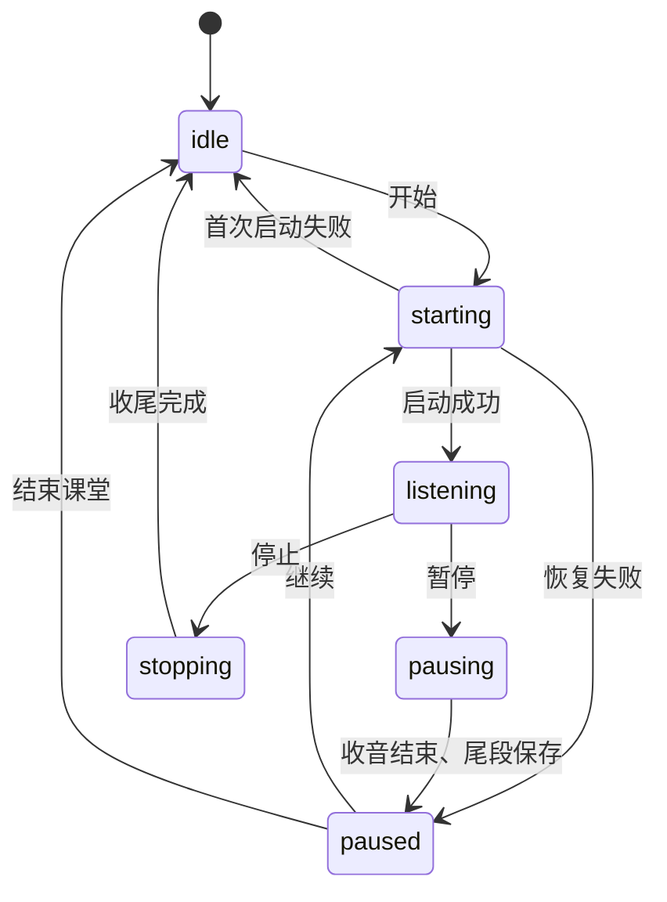

# 工程设计与取舍

## 目标与边界

目标是在 Mac 英文课堂中持续收音，尽快显示中文，并保留英文、时间范围和原音用于课后核对。当前版本为本机单用户应用，没有服务器或账号系统。

系统模型提供识别和翻译能力；应用负责输入输出组织、状态和并发控制。当前没有模型训练、微调、说话人分离或语义知识点检测。

## 模块

| 文件 | 职责 |
| --- | --- |
| `Sources/LocalSpeechEngine.swift` | 语言资产检查、AVAudioEngine 采集、音频转换、SpeechAnalyzer 生命周期、识别结果回调 |
| `Sources/Transcript.swift` | 原始片段、时间轴修订、段落缓冲、翻译快照校验、JSON 存储、废纸篓操作、导出 |
| `Sources/AppModel.swift` | 主线程状态、录音生命周期、预览节流、翻译队列、任务失效检查、保存协调 |
| `Sources/ContentView.swift` | 课堂列表、双语视图、设置、编辑和录音控制 |
| `Sources/ClassScribeApp.swift` | 应用入口、菜单、快捷键和退出收尾 |

## 选择系统端侧模型

课堂使用需要便携、及时显示和原音留在本机。Apple Speech 与 Translation 直接提供连续识别、临时结果、设备端翻译和系统语言资产管理，适合原生应用接入，也减少单独部署模型服务的依赖。

取舍是模型行为和支持语言受系统能力约束，无法在应用中直接替换权重或调整训练过程。后续若增加可切换识别后端，需要分别验证资源占用、隐私边界和实际课堂效果。不能仅凭模型名称或参数规模判断准确率。

## 持续变化的输入与翻译回复

识别结果不是只追加的字符串：临时片段可能扩展、修订，再转换为定稿。`TranscriptTimeline` 根据时间范围替换对应草稿并处理重复结果，`ParagraphBuffer` 保存原始识别片段并组织显示段落。

段落在定稿边界、目标时长附近或识别停顿时关闭。默认停顿阈值约 3 秒，目标时长为 25 秒，也可选 15 / 40 秒。这里的停顿依据识别更新与片段时间，不等于音频级语音活动检测，更不等于语义话题检测。

`TranslationJob` 携带课堂 ID、段落 ID、原文快照和任务类型。结果返回时重新验证段落仍存在、原文仍适用、翻译任务未失效且内容未被人工修改。定稿要求原文完全一致；预览要求原文快照仍是当前段落的前缀。

### 预览调度

- 默认首个预览约 0.6 秒后进入调度，后续按约 1.5 秒节流；这些是调度间隔，不是端到端延迟承诺。
- 连续输入不重置已有计时器，避免持续发言时预览一直被推迟。
- 同一段落的新快照替换旧的排队预览，避免请求持续堆积。
- 同时最多执行一个翻译任务，已关闭段落的整段定稿优先。
- 预览保持明确标记；段落结束后再次整段翻译，不能把预览当最终译文。

串行翻译使资源使用和结果顺序更容易控制，但长翻译可能阻塞后续任务。真正的尾延迟和预览新鲜度仍需要在真实音频负载下测量。

## 音频输入与积压

音频采集与转换通过专门队列处理，识别输入使用有界 `AsyncStream`。超过转换任务或输入缓冲限制时显式报告失败并停止，避免在用户不知情时静默丢弃识别输入。

这属于过载检测与停止策略，不代表已经实现自适应降级或无损无限缓存。关闭原音保存时也没有原音可供重放。

## 暂停、恢复、退出

暂停流程先停止接收音频，等待识别引擎收尾，关闭原音片段、补齐剩余段落并保存，再进入已暂停状态。恢复时从累计时长开始新的录音片段，暂停的墙钟时间不会进入录音时间轴。

每次录音运行具有新的标识，用来拒绝旧运行的迟到回调。开始、暂停、停止处于过渡状态时，退出操作等待过渡结束，再关闭剩余会话并保存。

`SpeechRecording` 接口、权限检查闭包和时钟函数可注入，测试无需实际打开麦克风即可验证失败、恢复、重复命令和退出竞态。

## 保存与恢复

- 课堂用 JSON 原子写入，收音期间定期保存快照，定稿和翻译完成后也保存。
- 原音使用独立 CAF 文件，JSON 保存关联文件名和累计时间范围。
- 新字段采用可选值以兼容已有记录；加载时将未完成翻译恢复为可重试状态。
- 意外断电仍可能丢失最后一次落盘后的内容；跨 JSON 和 CAF 并没有数据库级事务保证。
- 删除校验文件归属，将记录与关联原音移入归档后送往废纸篓；失败时尝试回滚。

## 后续评估计划

- 使用获得授权的真实课堂录音，测量英文词错误率、专业术语错误率和漏识别情况。
- 测量实际语音到首个中文、修订中文、整段定稿的延迟分布。
- 检查连续课堂使用时的资源占用、过载停止和恢复行为。
- 比较预览开关、段落长度和术语提示对结果的影响。

现有验证覆盖了工程逻辑与合成输入上的原生管线，不能代替这些课堂测量。
